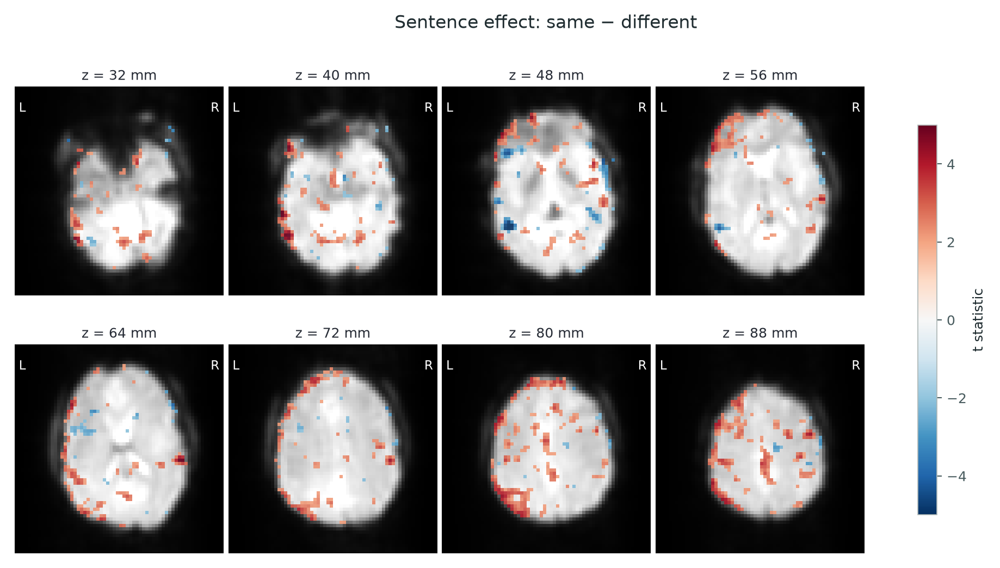



::: {.atlas-intro}
# fMRI models, from events to inference

fmrimod is a Python library for hemodynamic response functions, experimental
designs, first-level GLMs, contrasts, and group analysis. Describe the model,
fit it to preprocessed data, and inspect the results at each step.

::: {.reading-links}
[Install and fit a model](get-started.qmd)
[Browse the tutorials](tutorials/index.qmd)
[Look up an API](reference/index.qmd)
:::
:::

::: {.figure-plate}
::: {.plate-image}
[{fig-alt="Eight axial slices showing positive and negative FIAC same-sentence minus different-sentence t statistics."}](tutorials/real-data-fiac.qmd)
:::
::: {.plate-note}
## A contrast in brain space

Two runs of the published FIAC experiment, one participant, and a
same-sentence minus different-sentence contrast. Image geometry stays with
the estimates through the fit and back to a brain map.

These are uncorrected t statistics after 6 mm smoothing of the BOLD data.
The tutorial explains the design, pooling choice, and comparison receipt.

[Work through the FIAC analysis](tutorials/real-data-fiac.qmd)
:::
:::

::: {.atlas-body}
## See what goes into the model

Event timing becomes a regressor only after choosing a hemodynamic response
function (HRF). Compare the response shapes, inspect the design columns,
and check what a contrast asks of those columns before interpreting a map.

```{python}
#| echo: false
#| fig-width: 9
#| fig-height: 3.2
#| fig-alt: "SPM canonical and gamma hemodynamic response curves normalized to unit peak, showing different response shapes."
#| fig-cap: "Two HRF choices, each normalized to unit peak for this comparison. Equal peaks here do not imply equal native amplitude conventions."
from fmrimod.hrf import get_hrf
from fmrimod.plotting import plot_hrfs

fig, ax = plt.subplots(figsize=(9, 3.2))
plot_hrfs(get_hrf("spmg1"), get_hrf("gamma"),
          labels=["SPM canonical", "gamma"], normalize=True, ax=ax)
ax.set_title("")
ax.set_xlabel("Time after event (s)")
ax.set_ylabel("Normalized response")
plt.show()
```

[Explore the plotting guide](tutorials/plotting-visualization.qmd) or
[estimate an HRF from data](tutorials/estimating-hrfs.qmd), with fitted curves
and uncertainty intervals.

## Follow an analysis

::: {.analysis-route}
### [Events and design](tutorials/design-matrices.qmd)

Write an event table, select an HRF, and inspect the regressors and their
correlations. Add baseline terms and parametric modulators as needed.
:::

::: {.analysis-route}
### [Fit and contrast](tutorials/linear-model.qmd)

Fit a first-level GLM and compare named conditions. Follow a simulated effect
through the [complete workflow](tutorials/golden-path.qmd), or estimate
[responses to individual trials](tutorials/single-trial.qmd).
:::

::: {.analysis-route}
### [Group and diagnostics](tutorials/group-analysis.qmd)

Collect subject contrasts, choose a group model, and examine its results.
[Group diagnostics](tutorials/group-diagnostics.qmd) distinguish unusual
subject maps from subjects that strongly influence the pooled estimate.
:::

::: {.status-note}
fmrimod is source-installable alpha software for Python 3.10 and newer.
The [evidence guide](evidence/index.qmd) explains the checked-in comparisons
with R, Nilearn, and FitLins, including the
[active numerical caveats](https://github.com/bbuchsbaum/fmrimod/blob/main/docs/contracts/CAVEATS.md).
:::
:::
